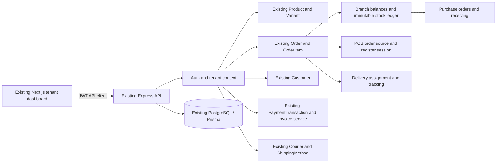

# Universal Business Management Architecture

## Assessment scope

This assessment covers the frontend in this repository and the sibling Express/Prisma backend at `../backend`. It is based on the checked-in application structure and workflows as they currently exist; it does not treat the planned capabilities below as implemented. No existing product, order, customer, payment, courier, or tenant module is to be replaced.

## Executive assessment

The application already has a usable ecommerce and tenant foundation:

- Next.js dashboard pages use a shared authenticated layout, sidebar, `AuthContext`, and Axios client.
- Express routes use JWT authentication. The JWT provides `id`, `role`, and `tenantId`; tenant-owned controllers generally scope reads and writes using that tenant ID.
- PostgreSQL is accessed through Prisma. `Tenant`, `Product`, `Variant`, `Customer`, `Order`, `OrderItem`, `InventoryLog`, `Supplier`, `Expense`, `PaymentTransaction`, `ReturnRequest`, `Refund`, `Courier`, and `ShippingMethod` already model relevant business concepts.
- Existing order listing, checkout, status changes, invoice generation, payment records, returns/refunds, courier integrations, suppliers, expenses, product variants, stock adjustment, and stock reporting are wired to the dashboard.

The missing foundation is organizational and operational rather than a second ecommerce stack. There is no `Branch` or register model, no branch-specific stock balance, no purchase/receiving workflow, and no POS order channel. Inventory is currently a single `Variant.stock` number with an `InventoryLog`; orders have no branch or source field. Delivery integrations exist, but the order-to-courier assignment is stored as loosely related order fields rather than a unified dispatch workflow. Tenant packages and `featureFlags` exist, but there is no subscription plan/entitlement service or consistent feature gate.

## Existing boundaries to preserve

| Concern | Current owner | Integration rule |
|---|---|---|
| Tenant identity and activation | `Tenant`, auth controllers, JWT, `requireActiveTenant` | Continue deriving tenant scope from the verified JWT, never from a caller-supplied tenant ID. |
| Catalog and pricing | `Product`, `Variant`, catalog controllers | POS and purchase receipts refer to existing variants; do not duplicate products or variant options. |
| Customer identity | `Customer`, order customer snapshot fields | Reuse the tenant customer record when possible; retain order-time customer details for historical receipts. |
| Sales | `Order`, `OrderItem`, order controller | Extend the existing order model with source and optional branch context. Preserve existing ecommerce defaults and endpoints. |
| Payments and invoices | `PaymentTransaction`, payment controller, invoice service | Reuse the order payment and invoice pipeline; add tender types and receipt rendering through compatible extensions. |
| Returns | `ReturnRequest`, `Refund`, return controller | Add stock disposition and location context to existing returns instead of adding a second return module. |
| Shipping and delivery | `ShippingMethod`, `Courier`, courier/Steadfast APIs, order status fields | Keep existing integrations. Add dispatch/assignment lifecycle around the existing order and courier records. |
| Admin presentation | `app/dashboard/*`, `components/dashboard/Sidebar.tsx` | Add pages within the current protected dashboard and use its navigation, language, toast, and API patterns. |
| Subscription | `Tenant.package`, `Tenant.featureFlags`, payment approval | Reuse tenant billing state; centralize feature checks before exposing paid business modules. Do not invent a parallel tenant billing identity. |

## Target architecture

### Tenant and authorization context

Keep the current authentication path. Resolve tenant membership and authorized branch IDs once in middleware/service boundaries; validate that the requested branch is active and belongs to the authenticated tenant. The current `User.role` values are free-form strings and the existing user controller has tenant-boundary gaps, so branch assignments and action permissions must be explicit before staff access is enabled. `SUPER_ADMIN` stays separate from tenant operators.

Use the tenant as the data ownership boundary and the branch as an operational scope beneath it. Every new tenant-owned row should have `tenantId` (including rows that also reference a branch), with composite unique constraints and indexes that begin with `tenantId`. Verify tenant ownership on every related ID in a transaction.

### Inventory source of truth

Introduce per-branch balances and an immutable movement ledger. The balance is the fast current value; the ledger is the auditable explanation of how it changed. All mutations—POS sales, confirmed online orders, receiving, transfer, return disposition, damage, and adjustments—must update balance and append ledger rows in a single database transaction.

Migrate each existing `Variant.stock` value into the tenant's initial/default branch. Keep `Variant.stock` as a compatibility projection during rollout for existing storefront code, then migrate every stock reader/writer and remove or deprecate the legacy field only after parity is verified. Do not maintain two independent stock truths.

### Sales and POS

Represent POS sales as existing `Order`/`OrderItem` records with an explicit `source` (existing ecommerce orders default to `ONLINE`) and optional `branchId`, register session, and cashier. Keep customer, tax/discount/shipping snapshots, payment transaction, and invoice behavior in the existing pipeline. POS prices and totals are calculated on the server from tenant-owned variants and settings; the client sends identifiers and quantities, not authoritative totals.

An accepted POS checkout must atomically validate branch availability, create the order and item snapshots, record each tender, decrement or reserve stock according to the agreed policy, append the ledger, and update the register session. A retry key prevents duplicate sales when a device retries after a timeout.

### Receiving, transfers, and returns

Use the existing `Supplier` and `Variant` records. Add purchase orders and line items with explicit draft/submitted/partially-received/received/cancelled states. Receiving is a separate idempotent operation, not a direct edit of a variant's stock. Transfers need a source and destination branch and a two-step in-transit/received lifecycle; create paired ledger movements only at the corresponding state transitions. Reuse existing returns and refunds, adding a return disposition/location so restockable, damaged, and quarantined quantities are handled distinctly.

### Delivery

Keep the existing order status history, courier credentials, and provider clients. Add a tenant/branch-scoped delivery assignment or dispatch record linked to the existing order and courier, retaining provider consignment IDs and tracking status. Provider callbacks must be tenant- and assignment-scoped and idempotent. Local pickup and POS orders do not need a courier assignment.

### Subscription gates

Use a single backend entitlement check based on the authenticated tenant's package/feature settings and active status. Apply it consistently to new API routes and dashboard navigation. The current `featureFlags` JSON has inconsistent string/object handling; normalize it at the service boundary before defining capability keys such as `branches`, `pos`, `purchasing`, and `delivery_management`. Plan/price lifecycle and billing provider are not present in the current repository and require a product decision before implementing paid plan changes.

## Cross-cutting invariants

1. A branch, product, variant, customer, supplier, order, purchase, and courier association must belong to the same authenticated tenant.
2. No balance mutation is accepted without an append-only ledger movement in the same transaction.
3. Use server-computed money and quantity values; introduce decimal-safe persistence for new monetary and stock data. Existing `Float` columns remain compatible until a separately verified conversion.
4. Sale, receipt, transfer, return, and payment operations are idempotent where clients/providers can retry.
5. Preserve existing `/api/orders` ecommerce behavior, order statuses, invoice URLs, and public checkout contracts unless a versioned compatibility change is explicitly approved.
6. Every lifecycle transition is validated server-side and recorded with actor, timestamp, and reason.
7. Dashboard role visibility is UX only; backend authorization is authoritative.

## Rollout and compatibility

1. Add schema and migration with a tenant default branch; backfill current variant stock into that branch without changing existing order history.
2. Add read-only branch inventory APIs and compare branch totals with legacy stock in staging.
3. Migrate stock reads and writes to a shared inventory service. Keep existing API response shapes where possible; expose legacy aggregate stock as a derived compatibility value.
4. Add receiving and branch transfers before enabling multi-branch sales.
5. Add POS as an `Order` source, preserving ecommerce paths and generating ordinary order invoices and payment transactions.
6. Add dispatch lifecycle and courier mapping without removing current courier/Steadfast operations.
7. Enable dashboard routes behind server-side entitlements and role checks, then roll out by tenant feature flag.

## Decisions to confirm before production enablement

- Whether one default branch is auto-created per tenant (recommended) and how tenants with no address name that branch.
- Whether a POS sale deducts stock immediately (recommended) and whether online orders reserve or deduct stock at confirmation.
- Whether fractional quantities are required for any product types; existing `Float` quantities allow them, while the initial recommended model uses bounded decimal quantities.
- Which tender methods, receipt formats, tax-inclusive/exclusive rules, and cash drawer workflows are required for the initial launch.
- Whether paid access uses the current manual payment approval flow or a new billing provider. The assessment does not assume a provider.

## Current assessment references

- Backend schema: [`../backend/prisma/schema.prisma`](../../backend/prisma/schema.prisma)
- API mounting: [`../backend/server.js`](../../backend/server.js)
- Auth/tenant middleware: [`../backend/middleware/authMiddleware.js`](../../backend/middleware/authMiddleware.js), [`../backend/middleware/requireActiveTenant.js`](../../backend/middleware/requireActiveTenant.js)
- Existing order workflow: [`../backend/controllers/orderController.js`](../../backend/controllers/orderController.js)
- Existing inventory endpoints: [`../backend/controllers/inventoryController.js`](../../backend/controllers/inventoryController.js), [`../backend/controllers/variantController.js`](../../backend/controllers/variantController.js)
- Dashboard shell and navigation: [`../frontend/app/dashboard/layout.tsx`](../../app/dashboard/layout.tsx), [`../frontend/components/dashboard/Sidebar.tsx`](../../components/dashboard/Sidebar.tsx)

